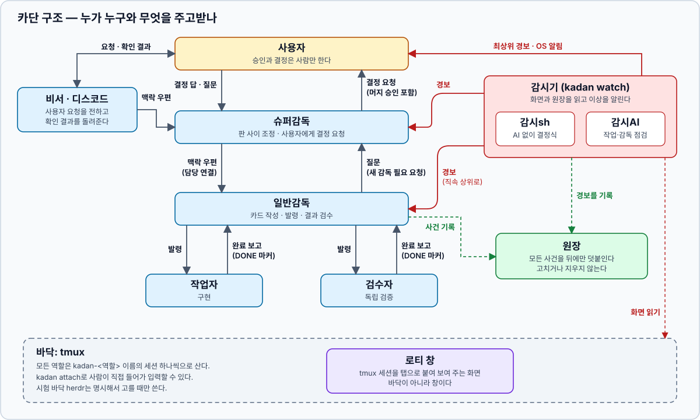
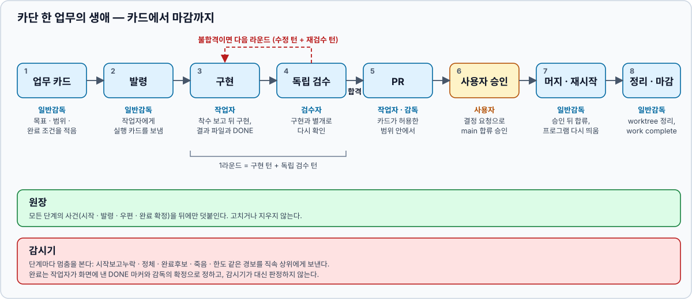

# kadan (카단)

**여러 AI CLI를 역할별 터미널로 띄워 놓고, 말을 걸고, 지켜보고, 필요하면 직접 들어가 개입하는 도구입니다.**

> **Run AI CLI agents (Claude Code, Codex, …) as named roles in tmux — start them, message them, watch for completion, and step in yourself.**
> Zero runtime dependencies (Node built-ins + tmux). The interface is currently Korean; contributions are welcome in any language.

> **AI에게 설치를 맡기려면 이 주소를 주세요:** [`docs/ai-install.md`](https://github.com/fwkyle/kadan/blob/main/docs/ai-install.md)
> (원문 그대로 읽게 하려면 [raw 주소](https://raw.githubusercontent.com/fwkyle/kadan/main/docs/ai-install.md)) — *Hand this URL to your AI agent to have it install kadan.*

## 한눈에 보는 구조

**사용자가 비서(또는 디스코드)에게 요청하면, 슈퍼감독이 일반감독에게 일을 넘기고, 일반감독이 작업자에게 발령해 구현시키고 검수자에게 독립 검증을 맡깁니다.**
역할은 모두 tmux 세션 하나씩으로 사는 평범한 AI CLI입니다. 감시기는 화면과 원장을 읽다가 멈춘 역할이 있으면 직속 상위에게 경보를 보내고,
모든 사건은 뒤에만 덧붙는 원장에 남습니다. 결정과 머지 승인은 사슬을 따라 올라가 사용자만 합니다(사용자가 Autopilot 단계로 미리 맡긴 밤에는, 관문을 통과한 PR을 슈퍼감독이 머지합니다).



화살표마다 오가는 것을 적었습니다. 역할 이름과 소통 경로의 원본은 [흐름 지도](docs/flows.md)입니다.

카단은 특정 AI를 감싸거나 흉내 내지 않습니다. 터미널에서 돌아가는 CLI라면 무엇이든 카단 안에서 돌아갑니다.

- 🧑‍💼 **역할로 나눠 맡깁니다.** 비서·감독·작업자·검수자가 각자 자기 tmux 세션에서 일합니다.
- ✉️ **말을 주고받습니다.** 역할끼리, 또는 사람이 역할에게 메시지를 보내고 읽음·답장을 확인합니다.
- 👀 **지켜봅니다.** 멈췄는지, 끊겼는지, 끝났는지를 감시해서 위 담당에게 알립니다.
- ✋ **언제든 끼어듭니다.** `kadan attach`로 실제 터미널에 들어가 직접 입력할 수 있습니다. 슈퍼감독을 한 화면에 모아 보면서 바로 입력하려면 `kadan board`(사이드바 / 세션 설명 / 터미널 세 칸, Ctrl-]로 목록 복귀).
- 📒 **기록은 지우지 않습니다.** 무슨 일이 있었는지 뒤에 덧붙이기만 하는 원장에 남깁니다.

## 한 업무의 흐름

업무 카드 한 장이 만들어져 마감되기까지의 순서입니다. 독립 검수가 불합격이면 다음 라운드로 구현에 돌아가고,
main에 합치는 일은 사용자가 승인해야 진행됩니다.



## 카단이 강제하는 것

- **생존 확인 후 전송.** 메시지를 넣기 직전에 세션이 살아 있는지와 PID를 확인하고, 아니면 보내지 않습니다. → [설계 원칙 2번](docs/design.md#잠긴-최소-규칙-이것만은-지킨다)
- **모호하면 실패 닫힘.** 원인을 모르는 실패는 다시 시도하지 않고 멈춰서 보고합니다. → [설계 원칙 3번](docs/design.md#잠긴-최소-규칙-이것만은-지킨다)
- **자기 것만 종료.** 카단이 만든 세션만 끌 수 있고, 사용자의 개인 tmux 세션과 섞지 않습니다. → [설계 원칙 4번](docs/design.md#잠긴-최소-규칙-이것만은-지킨다)
- **DONE 마커.** 완료는 에이전트가 화면에 직접 낸 `KADAN:DONE` 줄로만 알립니다. 마커가 없는 정지는 "조용함"으로 보고만 합니다. → [설계 원칙 6번](docs/design.md#잠긴-최소-규칙-이것만은-지킨다), [흐름 지도의 완료 보고](docs/flows.md)
- **append-only 원장.** 지난 사건은 고치거나 지우지 않고 뒤에만 덧붙입니다. → [설계 원칙 1번](docs/design.md#잠긴-최소-규칙-이것만은-지킨다), [원장 저장](docs/sqlite-storage.md)
- **사람의 머지 승인.** main에 합치는 일과 운영 배포는 사용자의 현재 시점 승인이 필요합니다. → [지휘 스킬](skills/kadan-conductor/SKILL.md), [흐름 지도의 사용자 결정](docs/flows.md)

## 카단이 하지 않는 것

- **AI별 어댑터를 만들지 않습니다.** claude·codex 같은 CLI마다 연결 계층을 쌓지 않고, 세션 안에 띄운 CLI를 그대로 씁니다. → [다시 만들지 않기](docs/design.md#다시-만들지-않기-본-카단에서-배운-것)
- **감시기가 AI 역할을 자동으로 다시 띄우지 않습니다.** 멈춘 역할은 경보로 알리고, 다시 띄울지는 감독이나 사람이 정합니다. → [설계 원칙 3번](docs/design.md#잠긴-최소-규칙-이것만은-지킨다)
- **원장을 고치지 않습니다.** 사건 수정·삭제·재정렬을 하지 않고, 파일을 직접 쓰지 않고 카단 명령으로만 기록합니다. → [설계 원칙 1번](docs/design.md#잠긴-최소-규칙-이것만은-지킨다)
- **headless를 기본으로 쓰지 않습니다.** `claude -p` 같은 방식 대신 대화형 화면 그대로 띄워, 사람이 보고 끼어들 수 있게 합니다. → [정체성](docs/design.md#정체성)

---

## 필요한 것

| 항목 | 버전 | 비고 |
|---|---|---|
| Node.js | **24 이상** | 저장소가 Node 내장 SQLite(`node:sqlite`)입니다 |
| tmux | 3.x | 기본 실행 바닥 |
| AI CLI | — | 비서로 쓸 `claude` 또는 `codex` 등 |
| OS | macOS / Linux | Linux에서는 창을 자동으로 열지 않고 붙는 명령을 알려 줍니다 |

설치 확인:

```bash
node -v    # v24 이상
tmux -V    # tmux 3.x
```

## 설치

```bash
git clone https://github.com/fwkyle/kadan.git
cd kadan
npm --prefix gui ci   # 대시보드 화면 빌드에 필요한 패키지 (카단 본체는 의존성 0개)
npm run build:gui     # 대시보드 화면 빌드
npm link              # `kadan` 명령을 PATH에 등록
kadan --help
```

> `npm link`를 쓰지 않으려면 `node <저장소>/src/cli.mjs <명령>`으로 똑같이 쓸 수 있습니다.

## 5분 시작하기

```bash
kadan init          # 처음 한 번: node·tmux 확인, 스킬 연결, 비서용 AI CLI 선택
kadan runners init --reason "처음 시작용 기본 프리셋"   # 역할별 실행기 기본 틀
kadan up            # 매일: 비서 세션 + 대시보드 세션을 띄움 (이미 있으면 그대로 사용, 감시 프로필이 있으면 감시기도)
kadan attach 비서   # 비서 터미널에 들어가 대화 시작
kadan doctor        # 막힌 곳이 있으면 한 번에 점검 (읽기 전용)
```

- 기본 설정에서는 `kadan up`이 출력한 tmux 명령으로 비서에 접속하세요. 창을 설정했다면 `kadan attach 비서`로 엽니다.
- `kadan up`이 대시보드 주소를 알려 줍니다. 기본은 http://127.0.0.1:8790 입니다.
- 비서는 카단 스킬을 알고 있어서, 원하는 일을 말하면 감독·작업자를 대신 꾸려 줍니다.
- 끝낼 때는 `kadan stop 비서`, `kadan stop 대시보드`.
- 감시기·대시보드 프로그램을 갱신한 뒤에는 `kadan stop watch`, `kadan stop 대시보드` 후
  `kadan up --hidden`으로 다시 켠다. `restart`는 AI 역할의 대화를 이어 여는 명령이다.
- 자주 쓰는 옵션: `kadan up --cmd 'claude' --port 8800 --no-prompt`

## 하던 대화를 카단으로 옮기기

AI와 평소처럼 이야기하다가, 그 대화를 통째로 카단 감독에게 넘기고 자리를 비울 수 있습니다.

- **말 한마디로**: 대화 중에 "감독으로 올려", "맡겨 놓고 갈래"라고 하면 그 대화의 AI가 아래 명령을 대신 실행합니다.
  `kadan init`이 연결해 주는 `kadan-go` 스킬이 있어야 합니다(`--no-skills`로 건너뛰었다면 동작하지 않습니다).
  "카단으로 해 줘"는 짧은 일이면 대화를 옮기지 않고 작업자 창만 띄우고, 오래 걸리거나 자리를 비울 일이면 옮기기를 먼저 권합니다.
- **명령 한 줄로**: 대화를 시작한 폴더에서 실행합니다. Claude Code 안에서는 대화 ID를 자동으로 읽습니다.

```bash
kadan adopt <이름> --model <모델>
```

- **요약본이 아니라 대화 전체가 넘어갑니다.** 지금까지의 대화를 복제해 새 감독 창으로 엽니다. 다시 설명할 필요가 없고, 권한 설정도 이어받습니다.
- **옮긴 뒤에는 원래 탭에 입력하지 마세요.** 복제한 뒤에 원래 탭에 친 말은 새 감독에게 넘어가지 않습니다.
  새 감독이 인수 확인을 마치기 전에 입력하면 그 확인이 거절되어 옮기기가 끝나지 않습니다. 이어서 할 말은 `kadan attach <이름>`으로 감독 창에서 합니다.

다른 방법과의 차이, 넘어가는 것과 넘어가지 않는 것은 [대화 옮기기 안내](docs/adopt.md)에 있습니다.

## 핵심 개념

| 개념 | 한 줄 설명 |
|---|---|
| **역할** | `kadan-<이름>` tmux 세션 하나. 예: `비서`, `감독`, `작업자-a` |
| **바닥(floor)** | 역할이 실제로 사는 터미널 층. 기본은 `tmux`. `herdr`는 명시적으로 선택하는 시험 기능. macOS 앱 `rottie`는 바닥이 아니라 창(`KADAN_WINDOW=rottie`)으로만 쓴다 |
| **원장(ledger)** | 시작·발령·우편·완료 같은 사건을 뒤에 덧붙이기만 하는 기록. 고치거나 지우지 않음 |
| **완료 마커** | 에이전트가 직접 출력하는 `KADAN:DONE <카드id> <ok\|failed>` 한 줄. 카단은 출력을 보고 완료를 짐작하지 않음 |
| **워크 / 카드** | 워크 = 약속한 결과 한 건, 카드 = 그 결과를 위해 한 담당에게 맡긴 일 한 건 |
| **우편** | 역할 사이의 메시지. 읽음 확인·답장 대기를 따로 추적 |
| **감시(watch)** | 멈춤·끊김·완료 후보·오래 안 읽은 우편을 위 담당에게 알리는 백그라운드 프로그램 |

누가 무엇을 어떻게 주고받고 감시가 무엇을 잡는지는 [흐름 지도](docs/flows.md) 한 장에 있습니다. 자세한 정의는 [용어사전](docs/glossary.md), 원장 구조는 [구조 기준](docs/architecture.md)에 있습니다.

## 직접 다뤄 보기

비서 없이 역할을 손으로 띄우고 일을 맡기는 흐름입니다.

```bash
kadan start worker-a --cmd 'codex'      # tmux 세션 kadan-worker-a를 만들고 원장에 기록
kadan dispatch worker-a --task card-1 \
  "card-1을 해 주세요. 끝나면 마지막 줄에 KADAN:DONE <카드id> <ok|failed> 형식으로 출력하세요. 카드id는 card-1입니다."
kadan wait worker-a                      # 완료 마커나 조용함을 알려 줌 (대신 판정하지 않음)
kadan attach worker-a                    # 실제 터미널에 들어가기
kadan status                             # 살아 있는 세션 목록
kadan stop worker-a                      # 카단이 만든 세션만 끌 수 있음
```

> 프롬프트에는 완료 마커의 **형식**만 적고, 완성된 마커를 그대로 넣지 마세요. 화면에 남은 마커를 완료로 잘못 읽을 수 있습니다.

> 기본 설치에서는 위 `kadan start`가 그대로 됩니다. 역할 이름을 프로필에 묶어 둔 설정([로컬 설정](docs/role-instructions.md#로컬-설정과-템플릿-교체)의 `roles`)에서 실행 모델 설정의 기본 명령과 다른 `--cmd`로 띄울 때만 `--reason "<이유>"`를 함께 줘야 합니다. 빠지면 시작이 거절되고, 거절 문구가 설정값을 알려 줍니다.

### 자주 쓰는 명령

| 명령 | 하는 일 |
|---|---|
| `kadan init` | 처음 한 번, 환경 확인하고 준비하기 |
| `kadan up` | 비서·대시보드 켜기 (매일) |
| `kadan attach 비서` | 비서 창 열기 (창 설정 시) |
| `kadan adopt <이름> --model <모델>` | 지금 하던 대화를 감독으로 이어 열기 |
| `kadan status` | 지금 켜진 역할 보기 |
| `kadan mail <역할> <말>` | 역할에게 메시지 보내기 |
| `kadan stop <역할>` | 역할 끝내기 |
| `kadan doctor` | 막힌 곳 한 번에 점검하기 |
| `kadan help --all` | 전체 명령 목록 보기 |
| `kadan start <역할>` | 역할 세션 만들기 |
| `kadan dispatch <역할> --task <카드ID> <지시>` | 명시한 실행 카드 발령 |
| `kadan send <역할> <메시지>` | 기존 호출 호환. 새 우편은 `mail`, 새 발령은 `dispatch` |
| `kadan wait <역할>` | 완료 마커나 조용함 기다리기 |
| `kadan read <역할>` | 화면 끝부분 읽기 |
| `kadan inbox` | 역할별 받은·보낸 우편, 답장 대기 보기 |
| `kadan watch` | 감시 시작 |
| `kadan wall` / `kadan dashboard` | 로컬 대시보드 |
| `kadan work` / `kadan card` | 워크·카드 관리 |

앞 9줄은 `kadan help`와 같습니다. 전체는 `kadan help --all`, 모든 명령과 옵션은 [명령어 사전](docs/commands.md)에 있습니다. 묶음 명령은 `kadan <명령> --help`로도 볼 수 있습니다.

## 데이터와 설정

- 모든 데이터는 `~/.kadan`에 저장됩니다. `KADAN_HOME`으로 바꿀 수 있습니다.
- 원장은 뒤에 덧붙이기만 합니다. 카단은 지난 사건을 고치거나 지우지 않습니다.
- 주요 환경 변수:

| 변수 | 뜻 | 기본값 |
|---|---|---|
| `KADAN_HOME` | 데이터 폴더 | `~/.kadan` |
| `KADAN_FLOOR` | 실행 바닥 (`tmux` \| 시험 기능 `herdr`) | `tmux` |
| `KADAN_HERDR_SOCKET` | herdr 시험 서버의 절대 소켓 경로. 별도 `KADAN_HOME`과 함께 지정 | 없음 |
| `KADAN_WINDOW` | 시작할 때 열 창 (`none` \| `rottie` \| `orca`). 비우면 `kadan window set`으로 고정한 기계 설정을 따른다 | `none` |
| `KADAN_SOCKET` | tmux 구획 이름 | `kadan` |

전체 목록은 [명령어 사전의 환경 설정](docs/commands.md#환경-설정)을 보세요.

herdr를 시험할 때는 [실행 방법과 미검증 범위](docs/experiments/herdr-roundtrip.md)를 확인하세요. 기존 tmux 데이터와 분리한 `KADAN_HOME`, 이미 실행한 named herdr 서버와 소켓이 필요합니다.

## 더 알아보기

| 알고 싶은 것 | 문서 |
|---|---|
| 처음 볼 전체 흐름(역할·소통·감시) | [흐름 지도](docs/flows.md) |
| 문서 전체 안내 | [docs/README.md](docs/README.md) |
| 왜 이렇게 만들었나, 바꾸지 않는 규칙 | [설계 원칙](docs/design.md) |
| 작업·우편 원장이 어떻게 연결되나 | [구조 기준](docs/architecture.md), [원장 계약](docs/mail-task-ledgers.md) |
| 하던 대화를 카단 감독으로 옮기기 | [대화 옮기기 안내](docs/adopt.md) |
| 이미 있는 역할의 담당을 다른 역할로 넘기기 | [인계 안내](docs/handover.md) |
| 우편 보내기·읽음·답장 | [역할 우편함](docs/secretary-mailbox.md) |
| 감시가 무엇을 언제 알리나 | [감시 기준](docs/watch-overview.md) |
| 대시보드 구조와 개발 | [대시보드](docs/dashboard-react.md) |
| 활동 기록의 조회 상태·복구 | [원장 조회 상태](docs/ledger-read-view.md) |
| 폰·밖에서 대시보드 보기(읽기 전용) | [원격 보기](docs/dashboard-remote.md) |
| 에이전트용 스킬 | `skills/` (conductor · super · secretary) |

## 테스트

```bash
npm test               # 본체 테스트 (격리 환경을 만들어 node --test를 돌린다: tests/run.mjs)
npm run test:gui       # 대시보드 요청·취소·시간 제한 계약
npm run build:gui      # 대시보드 타입 검사 + 빌드
npm run check:public   # 개인 경로나 작업 기록이 레포에 섞이지 않았는지 검사
```

## 기여

[CONTRIBUTING.md](CONTRIBUTING.md)를 먼저 읽어 주세요. AI 코딩 에이전트로 작업할 때도 같은 규칙이 적용됩니다.

## 라이선스

Apache-2.0. `LICENSE`와 `NOTICE`를 보세요.
