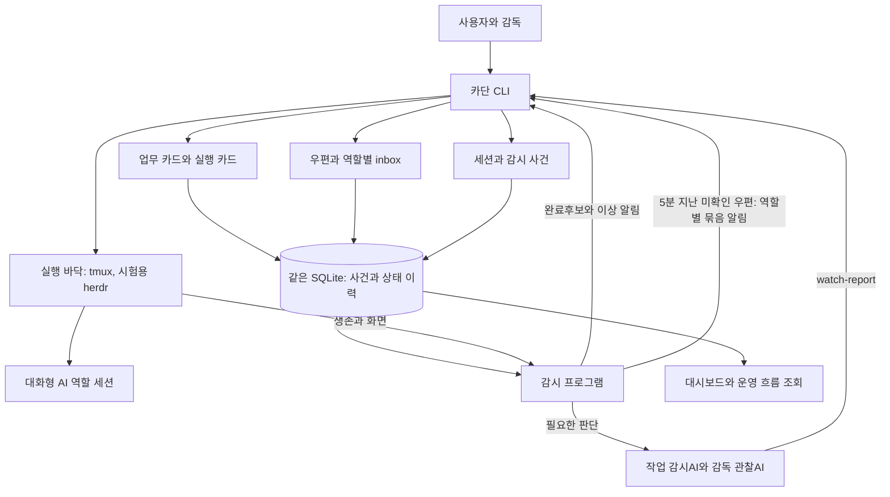
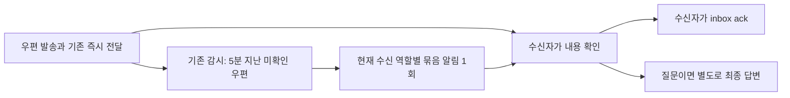

# 카단 구조와 원장 기준

## Why

사용자와 에이전트가 무엇을 맡았는지, 어떤 대화를 확인해야 하는지, 실행이 어디까지 끝났는지를 서로 혼동하지 않고 한 구조에서 확인하게 한다.

이 문서는 구성요소의 관계와 책임을 설명하는 기준 원본이다. 명령·저장 형식은 연결된 주제별 문서를 따른다. 변경 이력·시험 로그는 작업장 기록에 남기고 이 문서는 현재 구조로 갱신한다.

아래는 코드에서 확인한 구조와 동작이다. 실제 운영 DB 전환·감시기 재시작·터미널 수신 여부는 별도 작업 기록에서 확인한다.

## 한눈에 보는 현재 구조

미확인 우편 확인은 기존 감시 순회에 연결한다. UI 조회는 읽음·완료를 대신 기록하지 않는다.

## 각각 무엇을 맡는가

| 개념 | 답하는 질문 | 기준 원본 |
| --- | --- | --- |
| 업무 카드 | 어떤 결과를 누구 책임으로 완성하는가? | 목표·범위·완료 조건·책임 감독·연결 실행을 가진 업무 상태 |
| 실행 카드 | 그 결과를 위해 지금 누구에게 무엇을 맡겼는가? | 구현·검수·수정 등 실행의 범위·담당·진행 상태 |
| 실행 결과·검증 자료 | 무엇을 바꿨고 무엇으로 검증했는가? | 새 실행의 `cards/<저장소>/<실행ID>/result.md`·`evidence/`, 경로·지문·판정은 카드 이력 |
| 공통 실행 사건 원장 | 언제 발령했고 누가 실행을 끝냈는가? | `tasks/events.jsonl`의 plan·dispatch·done |
| 우편 | 누구에게 무슨 말을 했고 읽음·답변은 어떤 상태인가? | `mail/events.jsonl`과 본문 파일 |
| 역할별 우편함(inbox) | 내가 받은 편지·보낸 편지·답할 질문은 무엇인가? | 우편 원장의 역할별 조회. 역할마다 새 DB를 만들지 않음 |
| 시스템 사건 원장 | 어떤 세션이 시작·종료됐고 감시가 무엇을 했는가? | `system/events.jsonl` |
| 실행 바닥 | 어느 터미널에 입력하고 화면을 읽는가? | tmux(시험용은 herdr)의 실제 세션과 PID |

**공통 실행 원장은 실행 카드에 연결되는 사건 이력이다.** 별도의 업무 관리 체계를 하나 더 만드는 것이 아니다. 카드 상태 이력은 약속과 진행을, 공통 사건은 발령·실행 종료를 맡는다. 카드에 연결된 일반 질문도 새 실행은 아니다.

새 실행의 결과 보관·등록과 기존 경로 보존은 [카드 결과 저장 계약](card-center.md#카드-결과와-검증-자료)을 따른다.

카드는 할 일의 계약이고 우편은 전달 수단이다. 작업 지시는 `send --task`로 둘을 연결한다. 질문·답장은 카드 없이 보낼 수 있고, 기존 일에 관한 대화에는 `--work`·`--execution`을 붙인다. 단순 직접 작업까지 카드를 만들지는 않는다.

## 같은 저장소 안의 원장

| 영역 | 저장 스트림 | 범위 |
| --- | --- | --- |
| 작업 | `works/.../events.jsonl`, `cards/.../events.jsonl`, `tasks/events.jsonl` | 기존 업무·카드 상태와 공통 실행 사건 |
| 우편 | `mail/events.jsonl` | send·mail-read·mail-cancel. 질문과 답장은 send의 연결 정보 |
| 시스템 | `system/events.jsonl` | start·stop·alert·watch 등 공통 운영 사건 |
| 기존 전용 상태 | decision·brief·automatic-review 등의 기존 저장 경로 | 원장 분리만으로 합치거나 옮기지 않음 |

우편함 조회(`readMailboxLedger`)는 우편 영역에 세대 판정 근거인 start·stop과, 감시 알림이 실제로 들어간 `watch-mail-reminder`의 `sent` 결과(우편 ID·받는 역할·시각 등 최소 필드, 상위에게 간 `escalate`는 제외)를 원래 순서로 더한다. 감시기·대시보드와 같은 '넣은 시각'으로 `inbox`가 세대를 가르게 하려는 것이다. 예약·보류·못 넣은 결과는 더하지 않는다.

위 이름은 같은 DB 안의 스트림 주소이며 파일 경로가 아니다. 원장은 뒤에만 추가하며, 과거 `ledger.jsonl` 이력은 그대로 보존한다. 본문은 `mail/<지문>.txt`에 둔다.

우편과 작업을 연결하는 키는 다음과 같다.

- `workKey`: 전체 업무 주소.
- `executionKey`: 관련 실행 카드 주소. 이것만으로 발령을 뜻하지 않는다.
- `taskId`: 실행 발령·DONE을 연결하는 식별자. 짧은 ID와 정식 주소는 기존 [카드 주소 규칙](task-identity.md)을 따른다.
- `mailId`: 개별 우편 ID. `replyTo`는 답장 대상, `dispatchId`는 발령 우편과 실행 사건의 연결이다.
- `completionTaskId`: 자동 결과 우편이 설명하는 실행. 그 우편 자체를 발령으로 만들지 않는다.

`readLedger`는 기존 소비자를 위한 통합 호환 조회다. 발령을 send 형태로 한 번 보여주므로, 새 감시 코드가 모든 send를 터미널 입력이나 새 작업으로 해석하면 안 된다. 저장 원자성·조회 순서·구형 작성자 혼용 제한은 [원장 계약](mail-task-ledgers.md)과 [저장 운영](sqlite-storage.md)을 따른다.

## 서로 대신할 수 없는 상태

| 사실 | 누가 기록하는가 | 뜻하지 않는 것 |
| --- | --- | --- |
| 저장 | CLI와 저장 모듈 | 터미널 전달·읽음 |
| 터미널 전달 | 기존 send와 바닥의 전달 영수증 | AI가 읽음·착수·완료 |
| 읽음 확인(ack) | 내용을 확인한 수신 에이전트가 명시적으로 실행 | 승인·답변 완료·작업 완료 |
| 최종 답변(reply-final) | 현재 수신 책임자의 명시적 답장 | 자동 읽음·사용자 승인·DONE |
| 실행 종료(done) | 마커를 확인한 wait/자동 전달 또는 확인한 감독의 CLI | 검수 합격·전체 업무 완료 |
| 업무 완료(work complete) | 전체 결과와 근거를 확인한 책임 감독 | 개별 DONE만으로 자동 종료 |

`read`, 웹 본문 펼치기, 전송 성공, 답장, DONE에서 읽음을 추정하지 않는다. 읽음은 별도 `mail-read` 사건이다. 질문의 답변 대기는 `waiting → answered` 또는 `waiting → cancelled`이며 ack·중간 답장으로 닫지 않는다.

현재 CLI는 수신자 또는 사용자의 명시적 ack를 허용한다. **에이전트 운영의 기본은 각 수신자가 자기 우편을 확인하는 것**이며, 감시·발신자가 대리 ack하지 않는다. 사용자 수동 처리 예외는 기존 기능이다. `by`·`KADAN_ROLE`은 스스로 밝힌 역할이므로 인증된 신분으로 확대 해석하지 않는다.

## 읽음 확인과 미확인 우편 알림

일반 우편은 기존처럼 즉시 터미널에 넣는다. 원문 보존 `--raw`와 기록용 알림, 그리고 발령 우편을 제외한 메시지에는 우편 ID와 수신자 `inbox ack` 안내를 붙인다. `--raw`의 원문은 바꾸지 않으며, inbox에서 ID·본문을 조회한다. 보관된 우편(세션이 없거나 막혀 자동 보관, 비서·사람 앞 저장 전용)도 `inbox read`의 수신 안내로 확인한다.

**발령 우편과 감시 경보는 ack 대상이 아니다 (2026-10-05 [kyle] 소음 줄이기):** 카드 발령(`send --task`)은 읽음 확인 안내를 붙이지 않고 미확인 우편 재알림에서도 뺀다. 착수 보고(`card progress --activity running`)가 읽음의 자리를 대신하고, 5분 안에 착수 보고가 없으면 시작보고누락 경보가 잡는다. 답을 기다리는 발령(`--expect-reply`)은 질문이므로 예외다: 읽음·질문 안내가 둘 다 붙고 재알림 대상이다. 감시기의 경보 우편(정체·죽음 등)은 상태 변화로 닫히므로 기록용 알림(`notificationOnly`)으로 보내며 ack 안내·재알림이 없다. 해소는 우편 없이 원장 기록만 남기고, 경보 우편이 "행동 전 지금 상태를 확인하라"고 말한다([멈춤 규칙](watch-overview.md#멈춤-규칙-2026-10-05)). 미확인 우편 재알림과 놀고 있음 본인 알림도 같다. **감시기 알림 본문 틀(2026-10-21 [kyle]):** 감시기가 역할 창에 넣는 알림(경보·미확인 우편 재알림·상위 알림·놀고 있음 본인 알림)은 역할 지침을 붙이지 않는다(`guardedSend`의 `omitInstructions`, 원장에 지침 기록 `instructions`가 남지 않아 일반 우편의 전문·요약 판정에 끼지 않는다. 알림 전달이 실패해도 `send-failed` 전문 시도가 남지 않는다). 본문은 항목 이름을 붙인 틀이다(`watch-notice-format.mjs`). **미확인 우편:** `[감시sh] 미확인 우편 N건` 아래에 우편마다 `보낸이`(원래 우편 발신 역할, 감시기가 아니다)·`받는이`·`보낸 시각`(KST)·`첫 줄`(원장 `preview`, 없으면 본문 파일의 첫 줄을 비밀 가림 뒤 80자 이내로)·`확인:`·`읽음 기록:` 블록 하나(빈 줄로 구분), 5통까지 쓰고 넘으면 `외 N건 — kadan inbox --role <받는이> --unread`, 맨 아래에 읽은 우편만 직접 ack하라는 안내 한 줄. **상위 알림:** `[감시sh] 하위 역할의 미읽음 우편 N건` 아래 같은 블록에 `상태:`(N분째 미읽음|결과 불명)를 더하고, 읽음 기록 명령은 넣지 않는다(읽음은 수신자 몫). **놀고 있음·경보:** 첫 줄은 `[감시sh HH:MM] 요약` 그대로, 아래에 `대상`·`상태`·`근거`·(놀고 있음은 `본인 차례`)·`할 일`. 화면 출력·사용자 알림·원장은 요약 한 줄(`formatAlertBody`)을 그대로 쓴다. 이 틀은 ack 안내를 붙이지 않는 `notificationOnly` 알림이다.

**`--raw` 전달 읽음 (2026-09-27 [kyle]):** `--raw`는 본문 전체가 창에 들어가지만 우편 ID가 없어 수신자가 그 자리에서 ack할 수 없다. 그래서 창 전달이 성공(`keyDelivery: sent`)하면 send 기록에 `deliveredRead: true`를 함께 남기고 읽음으로 본다. 화면과 inbox는 이를 수신자 직접 ack(`readKind: recipient-ack`)와 구분해 **창 전달 읽음 · 수신자 확인 아님**(`readKind: delivered-read`)으로 표시한다. 전달이 실패하거나 불명확하면(전달 확인이 없는 바닥 포함) 기존처럼 안 읽음으로 남아 알림 대상이다. 보관 우편·일반 전달·질문은 자동 읽음이 없고, `--raw`와 `--expect-reply`는 함께 쓸 수 없으므로 전달 읽음이 답변 대기를 끝내는 일은 없다.

- **대상과 유예 — 상태표(2026-10-21 우편 단순화, 우편 표지 `mailRule`이 있는 우편만·비서 앞 제외):** 우편 ID가 있고 읽음 미확인인 편지를 아래 표 하나로 본다. 출처별(디코·슈퍼 간·저장 전용) 유예 분기는 없다.

  | 우편 상태 | 언제 알림 | 결과별 처리 |
  |---|---|---|
  | 한 번도 못 넣음(넣은 시각이 없음) | 매 순회(유예 0) | `not-sent`(보호·세션 없음)면 예약을 풀고 다음 순회에 재시도. 같은 우편·역할·단계에서 같은 사유의 재시도는 원장에 쓰지 않고(메모리로 센다) 첫 실패·사유 변경·`sent`·`unknown`만 쓴다. 사유 비교와 원장 `reason`은 오류 문장이 아니라 고정 값(오류 `code`, 없으면 `send-failed`)이다 — 문장에는 tmux 버퍼 이름(PID·시각) 같은 매번 달라지는 말이 섞여 압축이 샌다. 입력 보호 `held` 결과도 같은 압축을 지난다. `sent`면 넣음으로 바뀌고 그 시각이 넣은 시각. `unknown`이면 영구 예약, 재시도 금지, `needsCheck: true`로 기록 |
  | 넣음(`keyDelivery=sent` 또는 알림 `sent`) | 넣은 시각 + 5분에 1회(연결 업무가 `open`일 때만. 위 "한 번도 못 넣음" 첫 알림은 업무 상태와 무관) | 그 뒤 영구 예약 |
  | 상위 알림(`escalate`, 2026-10-21 [kyle] 승인) | (a) 재알림(`followup`)이 `sent`된 시각 + 15분(넣은 지 약 20분) 동안 수신자 ack 없음, 또는 (b) `initial`·`followup` 결과가 `unknown` — 다음 순회 | 수신자가 아니라 수신자의 직속 상위에게 간다. `sent`·`unknown`이면 영구 예약이고 `not-sent`(상위 세션 없음·입력 보호)는 위와 같은 압축으로 재시도한다 |

  **상위 알림(`escalate`)은 같은 단계 장치의 세 번째 단계다(새 경로 아님):** 우편·수신자 키(`reminderKey`)와 단계 이름 `escalate`로 `initial`·`followup` 옆에 기록하므로 평생 1회, 재시작 복원(`reminderHistory`), 같은 고정 사유의 `not-sent` 압축, 고정 크기 기록이 그대로 따라온다. 기록 종류는 `watch-mail-reminder` 그대로이고 `role`은 우편 수신자, 알림을 받은 상위는 `to` 칸이다. 우편함·`inbox`·발령은 이 기록을 우편으로 보지 않으며, `escalate`의 `sent`는 수신자에게 넣은 시각(`firstReminderSent`·우편함 조회)에 끼지 않는다. 받는 사람은 감시기가 쓰는 관계표(`parents`)의 직속 상위이고, 상위가 없거나 `@user`·`사람`·`비서`면 보내지 않는다(슈퍼감독의 상위는 `@user`라 슈퍼끼리 우편은 상위 알림이 없다). 대상은 `eligibleLetters`의 미읽음 판정을 그대로 쓰고(raw `deliveredRead` 포함), 연결 업무가 `open`이 아니면(done·cancelled·hold) 제외하며 연결 업무가 없으면 알린다. 한 순회에서 같은 상위에게 가는 것은 한 통으로 묶고 5건 + `외 N건`으로 자른다. 상위의 생존·PID·입력 보호(`hold`)는 상위의 것으로 검사한다. 상위가 죽었거나 PID를 모르면 `PARENT_UNAVAILABLE`(고정 코드)로 `not-sent`를 한 번 쓰고 압축된 재시도를 하며, 살아나면 1통 보낸다. 본문은 우편마다 항목 이름을 붙인 블록이다: 보낸이, 받는이, 보낸 시각(KST), 첫 줄(80자 이내·비밀 가림), 상태(`N분째 미읽음`(= 지금 − 넣은 시각) 또는 `결과 불명`), 확인 명령 `kadan inbox read <우편ID> --role '<수신자>'`. 값은 원장(첫 줄은 preview 또는 본문 파일)에서 오고 원장 기록에는 안내 글자를 쓰지 않는다. 확인 명령은 상위가 자기 `KADAN_ROLE`로 실행해도 남의 우편이 읽히고 읽음(`mail-read`)이 생기지 않는 것을 격리 CLI로 확인했다(`inbox ack`는 수신자 또는 사용자만 가능). 알림 밀림 장치와 입력 보호는 그대로 지나고 디코는 쓰지 않는다. 넣은 뒤 수신자가 죽어 `followup`을 못 하면(`currentPid == null`이면 예약 전에 건너뜀) (a)에 들어가지 않으므로 상위 알림도 없다 — kyle 지시를 문자 그대로 따른 결과이며 넓힐지는 kyle이 정한다.

  **넣은 시각은 `deliveredAt`(`src/mail-rule.mjs`) 하나다:** 창에 키로 전달됐으면(`keyDelivery`) 그 우편 시각, 아니면 그 우편·받는 역할에게 감시 알림이 처음 `sent`된 시각이다. 5분 시계와 세대 면제가 같은 함수를 쓴다. 5분은 저장 우편이면 알림이 `sent`된 시각부터 잰다(`mail.t`가 아니다). `result` 없이 `reserved`만 남은 예약은 예약으로 보지 않고 다시 시도한다. 첫 알림은 연결 업무 상태(`hold`·`done`·`cancelled`)와 무관하게 우편당 1번 낸다(받는 쪽이 아직 못 본 편지, 2026-10-20 retire_ooo 사고. 보류 업무 아래 질문이 약 3시간 묻힌 2026-10-27 사고로 `hold`도 더는 막지 않는다). 상위 알림과 넣은 뒤 5분 알림은 연결 업무가 `open`일 때만 나간다. 한 번도 못 넣고 저장된 우편(또는 받는 역할의 가장 최근 새 대화가 뜬 뒤에 처음 넣은 우편)은 이전 세대로 세지 않아 새 세대에게 알린다(알림은 본문이 아니라 inbox 확인 안내라 중복 실행 위험이 없다). 새 대화 앞에서 이미 넣은 우편(키 전달 또는 알림 `sent`)은 세대 필터를 그대로 쓴다. 새 동작은 새 코드가 쓴 모든 우편 기록(`send`·`mail`·자동 보관·디코 저장)에 붙는 `mailRule` 표지로 가른다. 날짜로 가르지 않으므로 발신(자동 보관)과 감시의 적용 경계가 같고, 표지 없는 옛 우편(원장은 지우지 않는다)과 비서 앞 우편은 옛 규칙(5분 유예, 저장 전용 유예 0, 슈퍼 peer·디코 유예 0)을 그대로 쓴다. 카드 없는 질문도 우편 알림 대상이지만 작업 감시AI 대상이 되는 것은 아니다. 별도의 판 활성 상태를 추측하지 않는다.
- **전달 전 확인:** 기존 start 원장과 실제 세션 PID가 맞아야 한다. 예약 뒤 읽음·인계·업무 상태와 생존을 다시 확인한다. 사용자·종료 역할을 기동하지 않으며 원문을 재전송하지 않는다.
- **재시작 중복 방지:** 시스템 원장의 `watch-mail-reminder`에 우편 ID와 현재 수신 역할별 예약(`reserved`)·결과(`result`)를 남긴다. 옛 규칙(표지 없는 우편) 우편은 같은 우편·같은 수신 역할을 한 번만 알린다. 예약만 남았거나 실패·전달 불명확이어도 재시작으로 자동 재전송하지 않는다. 새 규칙 우편은 `unknown`·`sent` 뒤에만 영구 예약이고, 못 넣은 상태는 재시작 뒤에도 원장의 첫 실패 기록과 미전달 판정만으로 재시도를 이어간다(상태 파일 없음. 같은 사유면 다시 쓰지 않는다). 후임으로 책임이 이전되면 그 후임에 대한 알림은 별도 한 번 가능하다.
- **사람 입력 보호(2026-09-23):** 알림 예약 전에 tmux 바닥에서 창에 붙은 사람의 마지막 키 입력(`client_activity`)이 30초(`--profile super` 슈퍼감독 창은 2분, 2026-10-22) 안이면 보류한다(2026-10-17부터 입력창 글 모양은 보지 않는다). 중계가 남기는 세션 옵션 `@kadan_human_input`(epoch 초)이 같은 기준 시간(30초, 슈퍼감독 창은 2분) 안이어도 사람 입력으로 본다([design.md](design.md)). 보류는 붙여넣기 전이므로 예약하지 않고 `watch-mail-held`를 사유별로 한 번만 남긴 뒤 다음 순회에 다시 본다. 확인과 붙여넣기 사이에 입력이 생겨 전송 검사에서 멈춘 경우에는 `result`에 `held:true`와 고정 코드(`KADAN_HUMAN_ACTIVE` 등)를 남기고 예약을 풀어 재시작 뒤에도 다시 시도한다(같은 코드면 다시 쓰지 않는다). 카드 전송·일반 우편도 같은 기준을 쓴다. rottie 바닥은 이 보류를 지원하지 않는다.
- **폴더 신뢰 확인 창 검사(2026-10-23, tmux):** Claude Code가 처음 보는 폴더에서 띄우는 'Is this a project you created or one you trust? · Yes, I trust this folder / No, exit' 창은 기본 선택이 "No, exit"라 우리가 보내는 Enter가 역할을 종료시킨다(rottie 작업자 3명 소실). 그래서 `send`·`mail`·`dispatch`·재안내·감시 알림이 모두 지나는 tmux 바닥 전송(`sendTmux`)이 첫 단계에서 화면(`capture-pane` 1회)을 읽어, **신뢰 창이 화면의 맨 끝**일 때만 신뢰 창으로 본다(공백을 걷고 비교, 2026-10-23 검수 F1~F6): 끝의 빈 줄을 걷은 뒤 비지 않은 마지막 줄이 `Enter to confirm`(· Esc to cancel)이고, 거기서 위로 가장 가까운 `Yes, I trust this folder` → `No, exit` → 질문 `Is this a project you created or one you trust`가 질문 → No → Yes → 안내 순서로 있어야 한다(범위는 비지 않은 마지막 60줄 — 폭 10글자로 줄이 감기면 사고 화면이 57줄이다). 모달은 화면 맨 끝에 그려지고 문구를 인용한 정상 화면은 대개 그 아래에 입력창·상태 줄·진행 표시 같은 글이 이어지므로, 인용은 안내가 마지막 줄이 되지 못해 통과한다. 위로 찾을 때는 **같은 모달 묶음 안에서만** 찾는다: 다른 `Enter to confirm` 줄이나 빈 입력창 줄(`❯`·`>` 하나뿐인 줄)을 만나면 거기서 멈춰, 위쪽 인용의 질문·선택지를 빌려 다른 모달(권한 확인·로그인 방식 선택 등)을 신뢰 창으로 오인하지 않는다(F7). **알려진 한계(F8):** 신뢰 창 문구를 전부 인용한 응답이 `Enter to confirm`에서 끝나고 렌더가 멈춘 순간은 문자열로 신뢰 창과 구별할 수 없다. 그때 일반 우편이 잠시 보관될 수 있다(안전한 쪽으로 틀린다). 보관된 우편은 유실되지 않는다: 감시기의 미확인 우편 재알림(`src/watch-mail.mjs`)이 순회마다 다시 시도하고, `KADAN_TRUST_PROMPT`는 입력 보호와 같은 보류라 예약을 풀고 다음 순회에 재시도하므로 화면이 바뀌면 `inbox read` 안내로 전달된다(우편 본문 자체는 받는 쪽이 `inbox read`로 읽는다).  감시기의 상태 판정(`readStatusLine`)에는 기대지 않는다. 신뢰 창이면 키를 한 번도 보내지 않고 `KADAN_TRUST_PROMPT`(`not-sent`)로 멈춘다. 구조가 아니거나 화면 읽기 실패는 지금처럼 보낸다(새 실패 원인을 만들지 않으려는 것). 일반 우편은 입력 보호 보류와 같이 보관으로 돌고, 발령(`--task`)은 보관하지 못해 오류로 끝난다. 풀려면 사람이 그 창에서 직접 고르거나 역할을 작업 저장소 폴더에서 다시 시작한다. 예방은 `kadan start`·`restart`의 작업 폴더 검사([commands.md](commands.md))가 맡는다.
- **재귀 제외:** 확인 알림 자체와 기록 전용 자동 완료 우편은 `notificationOnly: true`로 추가 미확인 알림에서 제외한다. 이 필드가 없던 과거 `systemGenerated: task-completion`도 제외한다. 읽음 기록은 자동으로 만들지 않고 원장에 그대로 두되, `inbox --unread`와 화면의 미확인 건수·필터에서는 뺀다(2026-09-27 [kyle]). 전체 목록에서는 **기록용 · 추가 알림 없음**으로 함께 표시한다.
- **질문 대기:** 읽음·중간 답장으로 답변 대기를 끝내지 않는다. 현재 수신 책임자의 최종 답변 또는 현재 발신 책임자의 취소로 종료한다. 새로운 답변 지연 자동 상신은 없다.

예약·결과는 알림 시도 기록이지 수신자의 열람 증명이 아니다. `ack`는 읽음 사건만 남기며 발신자에게 확인 편지를 보내거나 AI를 추가로 깨우지 않는다.

## 인계 뒤의 우편 책임

시스템 원장에 확정된 `handover/transferred`가 추가되면 그 시점에 존재한 우편별로 수신·발신 책임을 후임에게 이전한다. 전역 역할 이름 치환은 아니다. 준비·인수 수락만으로 이전하지 않는다. 여러 번 인계해도 저장 순서로 책임을 이어가며 동일 인계 ID의 상충하는 참가자는 오류로 처리한다. 이전 뒤 같은 이름으로 새로 받은 독립 우편까지 과거 인계에 소급해 후임에게 넘기지는 않는다. 원본에 연결된 늦은 답장·자동 결과는 원본 발신자의 현재 책임을 이어받는다.

원문의 `role`·`by`와 본문은 보존한다. 조회 결과의 `currentRecipient`·`currentSender`가 현재 책임자다. 받은/보낸 편지·답할 질문·답변 대기 필터와 후임의 읽음·답장·취소 자격은 현재 책임을 따른다. 과거 사건의 읽음·답변 자격은 사건 당시까지 확정된 인계로 판단한다. 화면은 원래 발수신 정보와 현재 책임을 함께 보여주고, 현재 필드가 없는 과거 조회값은 원래 역할을 사용한다.

CLI에서 옛 발신자 주소로 `--reply-to` 답장을 보내도 실제 터미널 목적지는 원본 발신자의 현재 책임자로 정한다. 인계로 목적지가 바뀌면 후임의 start 기록과 PID가 있어야 하며, 실제 생존·PID 대조를 생략하지 않는다. 전달 직전 책임자가 다시 바뀌면 자동으로 다른 세션에 보내지 않고 중단한다. 새 전송 기록의 수신자는 실제 목적지이며 원본 편지의 발수신 정보는 그대로다. `--raw`도 같은 주소·PID 검사를 유지한다.

우편 조회에 인계·완료 근거를 포함하는 방식은 [원장 계약](mail-task-ledgers.md#기록과-조회-계약), 실제 전환 순서는 [인계 안내](handover.md)를 따른다.

## 완료가 흘러가는 현재 경로

수동 실행은 **결과 파일 → 새 실행은 카드에 결과 등록 → 직속 감독에게 완료 통지 1회 → 자기 DONE 마커 → 감독의 근거 확인과 done 기록**이다. watch의 완료후보는 누락을 보완하는 알림이며 그 자체가 done은 아니다. 자동 왕복은 auto-report와 DONE을 프로그램이 확인하고 정상 중간 통지 없이 다음 실행을 연결한다. [발령과 대기](../skills/kadan-conductor/references/dispatch-wait.md)가 절차 원본이다.

SQLite에서 done 사건과 자동 결과 우편은 같은 트랜잭션으로 기록된다. 코어가 원본 발령자를 확인할 수 있는 최초 완료에 결과 우편을 저장한다. 과거 중복 done을 다시 써서 소급 우편을 만들지 않는다. 자동 결과는 원본 발신자의 inbox에 저장되며 터미널을 깨우지 않는다.

자동 결과 우편은 기록용이므로 추가 미확인 알림에서 제외한다. 수동 완료 보고와 자동 왕복의 최종 PASS·예외·블록 경계 통지는 기존 정상 터미널 우편을 유지하고 실행 주소로 연결한다. 이 최종 통지는 수신자의 ack와 미확인 알림 대상이다. 자동 저장이 기존 최종 통지를 대신하지 않으며 검수 PASS와 업무 완료는 계속 별개다.

## 기존 감시와의 경계

| 항목 | 현재 기준 |
| --- | --- |
| 작업 감시 | assigned 카드와 실제 미완료 발령을 기준으로 선별. 우편만으로 작업이 되지 않음 |
| 정상 입력 대기 판단 | 현재 실행의 발령 뒤 보낸 답변 대기 질문을 근거로 판단. 일반 통지·완료 결과·이미 닫힌 질문을 대기로 간주하지 않음 |
| 429 재개 직전 검사 | 저장 전용 mailbox를 터미널 입력 변경에서 제외 |
| 감시AI 문맥 | 최근 우편의 저장/전달·읽음·답변 상태와 현재 책임자를 포함 |
| 감독 멈춤 2단 | 할 일이 있는데 멈춘 감독에게 15분이면 본인, 15분 더면 상위(사람이 입력 중이면 본인 알림을 미룸). 해소 우편 없음. 미확인 우편 묶음 알림과 구별. 타이머식 `--wake` 자가점검은 2026-10-05에 없앰 |
| 읽었지만 미답인 질문 | 질문 대기 유지. 읽음 알림·DONE·업무 완료로 대체하지 않음 |

원장 오류는 대상 0명으로 처리하지 않는다. 새 배달 확인 서비스·별도 우편 감시AI·자동 읽음을 만들지 않는다. 코드와 격리 시험은 운영 반영 증거와 구분한다.

## 구현 근거와 문서 책임

| 범위 | 상세 원본 | 구현 근거 |
| --- | --- | --- |
| 업무와 실행 | [업무 카드와 실행](business-work.md) | [work-store](../src/work-store.mjs), [card-store](../src/card-store.mjs) |
| 원장과 우편 상태 | [작업·우편 원장 계약](mail-task-ledgers.md) | [ledger-domains](../src/ledger-domains.mjs), [mailbox-state](../src/mailbox-state.mjs), [mail-routing](../src/mail-routing.mjs) |
| 명령과 수신자 확인 | [역할 우편함](secretary-mailbox.md) | [mailbox](../src/mailbox.mjs), [cli](../src/cli.mjs), [work-mail](../src/work-mail.mjs), [mail-instructions](../src/mail-instructions.mjs) |
| 감시 | [감시 기준](watch-overview.md) | [watch-scope](../src/watch-scope.mjs), [watch-report](../src/watch-report.mjs), [watch-runner](../src/watch-runner.mjs), [watch-mail](../src/watch-mail.mjs) |
| 완료와 인계 | [자동 왕복](automatic-review.md), [인계](handover.md) | [automatic-review](../src/automatic-review.mjs), [handover](../src/handover.mjs) |
| 저장·전환 | [SQLite 저장 운영](sqlite-storage.md) | [storage](../src/storage.mjs) |

설계 원칙과 잠긴 제약은 [design.md](design.md)에 유지한다. 이 문서는 관계와 개편 경계를, 각 주제 문서는 실행 가능한 명령과 상세 조건을 맡는다. 운영 전환 시 구형 watch/wall/wait 작성자와 신형 작성자를 섞지 않으며, 코드 커밋·시험·실제 운영 반영을 각각 구분한다.
